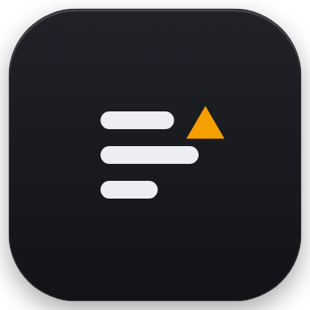
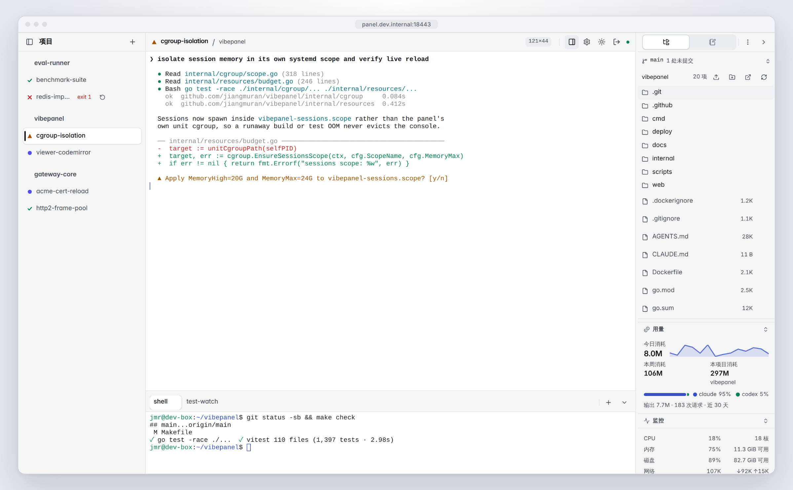
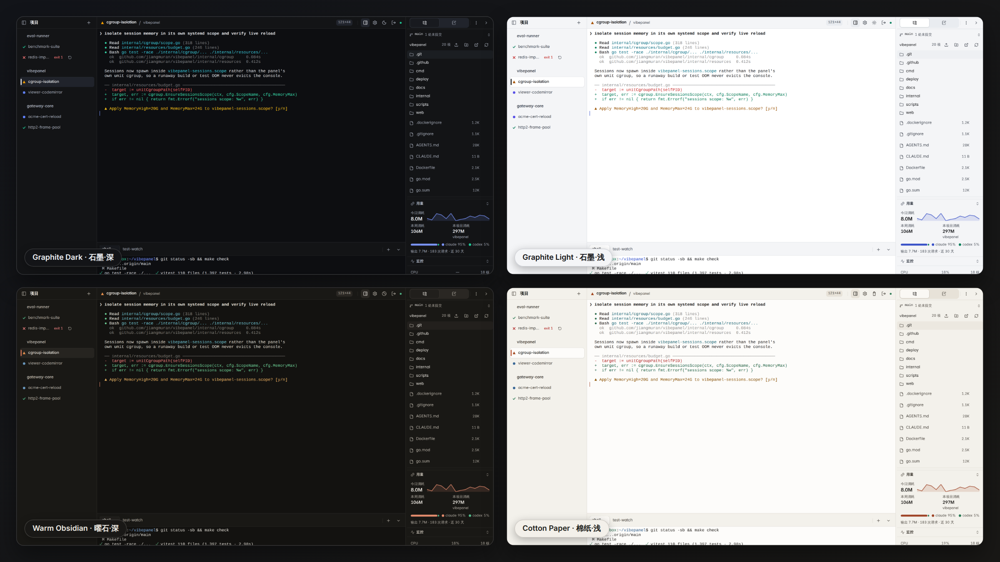
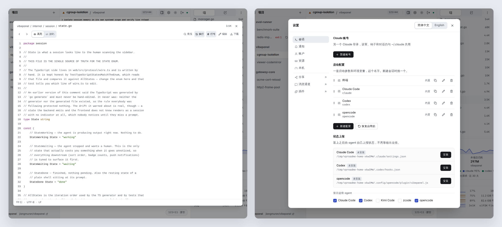
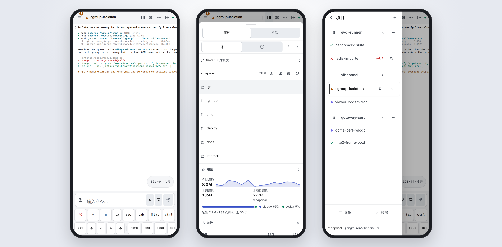
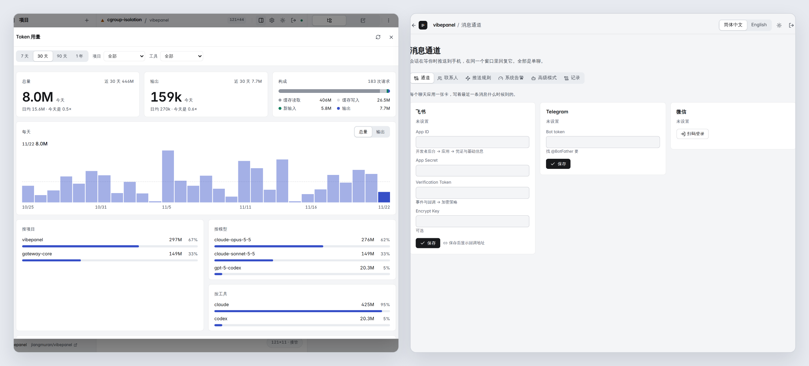
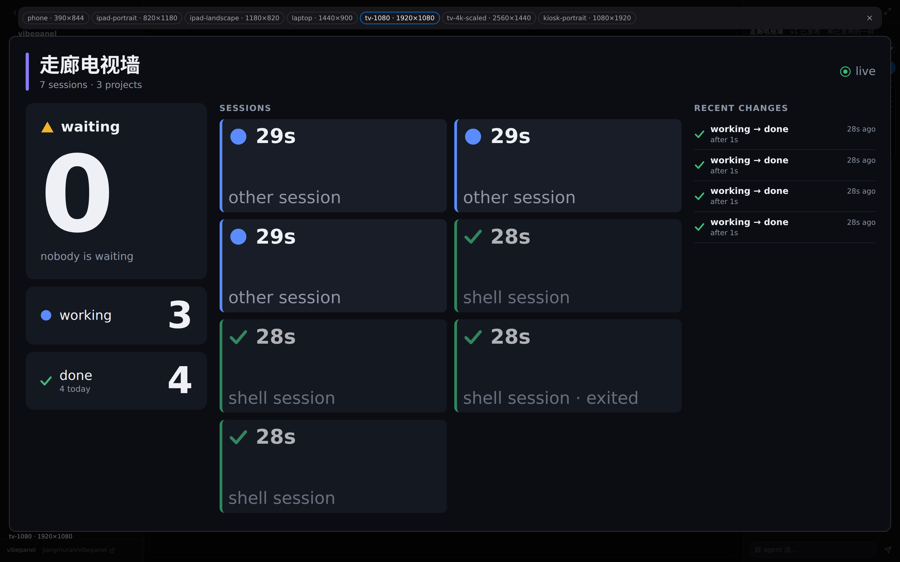
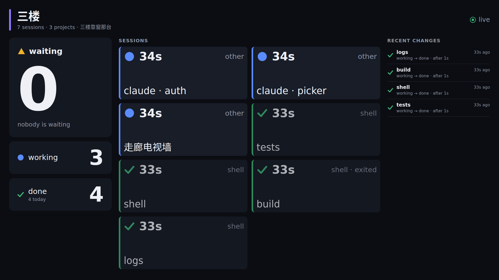
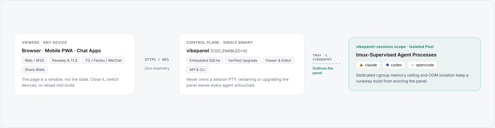

<div align="center">



# vibepanel

**A self-hosted web workbench for running parallel coding-agent sessions across projects.**

[](https://github.com/jiangmuran/vibepanel/releases/latest)
[](https://github.com/jiangmuran/vibepanel/actions/workflows/check.yml)
[](https://github.com/jiangmuran/vibepanel/actions/workflows/release.yml)
[-00ADD8?logo=go&logoColor=white)](go.mod)
[](LICENSE)

**English** · [简体中文](README.zh-CN.md)

[Quick Install](#quick-install-linux--macos) · [Features](#what-it-does) · [Mobile & Chat](#mobile-console--im-bridge) · [Architecture & Security](#architecture--security) · [CLI & API](#cli--http-api) · [Verification](#active-maintenance--verification)

</div>

<br>

<p align="center">
  <picture>
    <source media="(prefers-color-scheme: dark)" srcset="docs/images/hero-dark.png">
    
  </picture>
</p>

## Why vibepanel

Once you have eight or ten Claude Code, Codex, or opencode sessions running across three repositories, raw terminal tabs stop scaling. You end up cycling through tabs to find out which agent finished, which one stopped ten minutes ago to ask permission for a command, and which runaway test suite is eating all the RAM on your dev box.

vibepanel separates process lifetime from the interface. Every terminal lives inside a dedicated `tmux` socket and its own `systemd` cgroup memory pool; the web console ships as a single static Go binary (`CGO_ENABLED=0`) that owns organization, naming, state tracking, file browsing, and remote access. Restarting the service, upgrading the binary in place, or hitting an OOM inside one session leaves every other running agent untouched.

On a desktop it is a fast three-column workbench. On a phone it switches to a touch-first console with an IME-safe compose dock and tactile terminal keys. And when you are away from a browser altogether, pairing Telegram, Feishu (飞书), or personal WeChat (微信) delivers waiting-session cards straight to a 1-on-1 chat where you can tap *Allow*/*Deny*, request a live PNG screenshot, or type a reply back into the pane.

---

## Quick Install (Linux / macOS)

The interactive installer speaks English and 简体中文, verifies archives against `SHA256SUMS`, checks `tmux`, and sets up a `systemd` unit (system or user) or macOS `launchd` service.

### Standard

```sh
curl -fsSL https://raw.githubusercontent.com/jiangmuran/vibepanel/main/install.sh | sh
```

### Restricted networks (mirror)

A public mirror maintained by `jiangmuran` (the first run prompts for a one-time browser check to prevent abuse):

```sh
curl -fsSL https://github.muran.tech/https://raw.githubusercontent.com/jiangmuran/vibepanel/main/install.sh -o vibepanel-install.sh \
  || curl -sSL https://github.muran.tech/https://raw.githubusercontent.com/jiangmuran/vibepanel/main/install.sh
sh vibepanel-install.sh --mirror
```

### Service lifecycle

```sh
vibepanel service status | start | stop | restart | logs | token | upgrade | uninstall
```

Unattended installs, user vs. system units, creating the first account from the CLI, Docker setup, and building from source are documented in [docs/install.md](docs/install.md).

---

## What It Does

### 1. Multi-project session orchestration & four built-in themes

- **Glanceable state by shape and color**: Sessions group under their project and encode state with distinct geometry as well as hue—`▲` waiting on you, `●` working, `✓` done, `□` exited cleanly, `×` exited non-zero—so status stays legible in a dark room at 2am or with color-vision deficiency.
- **Project-scoped scratch terminals**: A collapsible bottom terminal strip follows the active project rather than a single session, giving you a shell right below the agent to inspect `git diff` or run a command without interrupting the conversation.
- **Two design languages, four built-in palettes**: Ships with **Graphite Light / Graphite Dark** (crisp neutral surfaces and monochrome primary controls) and **Cotton Paper / Warm Obsidian** (low-glare warm paper and mineral charcoal tones), applied before first paint with zero flash, alongside support for plugin themes.

<p align="center">
  
</p>
<p align="center"><sub>Built-in palettes: Graphite Dark &amp; Light alongside Warm Obsidian &amp; Cotton Paper</sub></p>

### 2. Built-in file viewer, in-place editor & exact agent hooks

- **Read and edit without leaving the console**: Browse project trees, paste clipboard screenshots directly into a session, and keep per-project notes. Opening a file renders syntax-highlighted code and diffs, GitHub-flavored Markdown, PDFs (with search and zoom), Jupyter `.ipynb` notebooks, SQLite tables, `.zip`/`.tar` archives, media, font specimens, and virtualized 50,000-line logs. Press `e` on any UTF-8 text file to edit in place with CodeMirror 6, guarded by `If-Match` ETags so you never silently overwrite a file an agent modified in the meantime.
- **Real agent hooks, not bell-guessing**: One click in *Settings → Sessions* installs state-reporting hooks into **Claude Code, Codex, Kimi Code, zcode, opencode, and agy**, previewing the exact config diff and backing up your file first. Manage multiple Claude accounts and reusable launch profiles with secret environment variables from the same screen.

<p align="center">
  <picture>
    <source media="(prefers-color-scheme: dark)" srcset="docs/images/viewer-settings-dark.png">
    
  </picture>
</p>
<p align="center"><sub>Left: built-in file viewer &amp; CodeMirror editor · Right: multi-account management, launch profiles, and one-click agent hooks</sub></p>

### 3. Mobile console & IM bridge

- **Built for thumbs and IMEs**: Narrow screens get a full-bleed terminal canvas, an IME-safe compose dock (preventing CJK composition keystrokes from hitting raw PTYs or voice dictation from double-submitting) with direct photo/screenshot attachment, a collapsible bar of tactile terminal keycaps (`^C`, `y`, `n`, `esc`, `tab`, `⇧tab`, sticky `ctrl`/`alt`), and a one-tap bottom sheet for files, token spend, and scratch shells.
- **Telegram, Feishu (飞书) & WeChat (微信)**: Written in-house inside the same binary with zero third-party SDKs. When an agent pauses for approval or asks a question, a numbered card lands in your 1-on-1 chat—with inline *Allow* and *Deny* buttons on Telegram and Feishu. Reply `3: run the race tests` to send input, `shot 3` for a rendered PNG of the pane, or enable the natural-language assistant mode where headless Claude Code / Codex translates your intent and waits for an explicit `ok` before writing to any session.

<p align="center">
  <picture>
    <source media="(prefers-color-scheme: dark)" srcset="docs/images/mobile-showcase-dark.png">
    
  </picture>
</p>
<p align="center"><sub>Left: full-bleed terminal, compose dock &amp; collapsible keycaps · Center: bottom-sheet workspace switcher · Right: project &amp; session drawer</sub></p>

### 4. Local token ledger, memory isolation & shareable screens

- **Local token accounting**: Parses local agent transcripts on disk to surface a live 14-day sparkline in the dock and a full dashboard with a 53-week heatmap, input/output/cache breakdown, and rankings by project, model, tool, and session.
- **Session cgroup memory pool**: Sessions run inside `vibepanel-sessions.scope`. When memory pressure climbs, an alert bar names the responsible session and child process tree so you can freeze (`SIGSTOP`) or terminate it while the panel itself stays responsive.
- **Sandboxed share pages & capability plugins**: Have an agent build custom status walls or dashboards beside a live multi-screen preview, then publish read-only or schema-validated interactive links served inside a strict `sandbox` iframe with redacted snapshots. Extend the panel itself through capability-scoped plugins ([docs/plugins.md](docs/plugins.md)) across themes, panes, budgeted `server.js` handlers, and supervised child processes.

<p align="center">
  <picture>
    <source media="(prefers-color-scheme: dark)" srcset="docs/images/observability-dark.png">
    
  </picture>
</p>
<p align="center"><sub>Left: local multi-project, multi-model token ledger · Right: self-contained IM channel setup (zero outbound connections until enabled)</sub></p>

<p align="center">
  
  
</p>
<p align="center"><sub>Share pages: author beside a live preview scaled to TV, laptop, or phone dimensions, then publish a scoped link (<a href="docs/features.md#screens-for-other-people">guide</a>)</sub></p>

---

## Architecture & Security

<p align="center">
  <picture>
    <source media="(prefers-color-scheme: dark)" srcset="docs/images/arch-en-dark.png">
    
  </picture>
</p>

- **Single static binary, zero telemetry**: Compiled with `CGO_ENABLED=0` with the web assets, pure-Go SQLite, and screenshot fonts embedded. Nothing is fetched from CDNs at runtime, and nothing phones home. Terminates its own TLS (self-signed, hot-reloaded custom certificates, or automatic ACME) behind password + WebAuthn Passkey authentication.
- **Strict `tmux` and PTY separation**: Operates exclusively against its own `-L <socket>` (default `vibepanel`) using exact `=name:` target matching, leaving your personal `tmux` or `zellij` server untouched. Because the Go server never parents a session PTY, `Settings → Updates` can download a new release, verify `SHA256SUMS`, smoke-test the binary, and restart in place with zero session loss.
- **Route-narrowed credentials**: Share links, page-admin grants, chat-tool tokens, and plugin credentials each live in separate tables that general session authentication never consults, and every route prefix is pinned by router-walk tests. Chat integrations make zero outbound connections until you explicitly accept the disclosure prompt and enable a channel.

---

## CLI & HTTP API

The `vibepanel` binary doubles as a full CLI client against the running panel ([docs/cli.md](docs/cli.md)):

```sh
# Inspect and drive projects and sessions from a shell or container
vibepanel status
vibepanel session new --project vibepanel --title "release-audit" -- claude
vibepanel session send release-audit "run make check" --enter

# Inside a panel-managed session, an agent can report its own progress via a session-scoped token
vibepanel me info set summary "Running browser regression suite"
vibepanel me info set progress 75
vibepanel me say "All checks green, ready for review"
```

Everything the web UI does is backed by the same HTTP + WebSocket API ([docs/api.md](docs/api.md)):

```sh
TOKEN=…   # Settings → Account → API tokens

curl -sX POST https://panel.example.com:18443/api/sessions \
  -H "Authorization: Bearer $TOKEN" \
  -H 'Content-Type: application/json' \
  -d '{"projectId":"…","title":"billing","command":["claude"]}'
```

Every CLI flag has a `VIBEPANEL_<UPPER_SNAKE>` environment variable equivalent; unknown or renamed `VIBEPANEL_*` variables are reported loudly at startup and by `vibepanel doctor` rather than silently ignored.

---

## Active Maintenance & Verification

vibepanel is actively maintained and used daily in production across 40+ releases (`v1.43.x`), with architectural decisions and post-mortems recorded chronologically in [docs/build-log.md](docs/build-log.md). Every release is built and smoke-tested end-to-end by public GitHub Actions workflows.

```sh
make check         # Fast gate: go vet, gofmt, tsc, eslint, Go -race tests (real tmux), vitest
make head-check    # Build and test a clean detached worktree at HEAD, verifying zero bundle drift
make verify        # Full gate: runs all 16 real-browser and container suites concurrently
```

Alongside Go `-race` tests (run against a real `tmux` on a throwaway socket rather than mocks) and frontend unit/contrast/contract guards, changes are verified by **16 dedicated Playwright browser and Docker `systemd` suites**:

| Suite | Coverage |
|---|---|
| `make render-check` | Layout, session states, multi-viewer arbitration, WCAG contrast probe, mobile tap targets, clipboard, Passkeys |
| `make preview-check` | File viewer & editor: every supported format across 3 widths × 2 themes, keyboard nav, 50k-line scroll rate, CRLF/BOM-preserving saves |
| `make stress-check` | Wide CJK alignment, full-screen TUIs, scrollback, output floods, dropped WebSockets |
| `make restart-check` | Kills the backend process and verifies all sessions and auth cookies survive |
| `make resources-check` | cgroup readings, memory pressure prompt, freezing/killing processes while keeping the UI responsive |
| `make isolation-check` | Session scope placement and upgrades against real `systemd` 249, 252, and 259 as PID 1 in Docker |
| `make chat-check` | Adapter cards, Feishu handshake, routing rules, read-only tools door, deep links, bilingual responsive layout |
| `make pages-check` | Sandbox escape attempts from inside a share page, live preview/publish/trial loop, every template × screen size |
| `make plugins-check` | Install consent screen, withheld grants, sandbox isolation, mounted HTTP processes, custom themes |
| `make panes-check` | Side-panel pane drag, split, merge, keyboard resize, and layout persistence |
| `make first-run-check` | One-time setup token wizard, untrusted-origin prompt, and first project creation |
| `make archive-check` | Archiving, directory-picker restore shelf, idle auto-archive, and live `tmux` verification |
| `make scale-check` | Two dozen concurrent sessions: snapshot payload size, sidebar reachability, poller load |
| `make tls-check` | Built-in TLS termination, `wss://`, `Secure` cookies, and live certificate rotation |
| `make sudo-check` | Elevated self-upgrade across `sudo` 1.9 and `sudo-rs` down every `sudoers` configuration |
| `make install-check` | Network bootstrap and `deploy/install.sh` across Linux/macOS, six package managers, and both languages |

---

## Documentation

| Guide | Topic |
|---|---|
| [docs/install.md](docs/install.md) | Installer modes, service units, flags & environment variables, Docker, building from source |
| [docs/features.md](docs/features.md) / [docs/features.zh-CN.md](docs/features.zh-CN.md) | Full user guide covering sessions, hooks, mobile, IM chat, share pages, and plugins |
| [docs/cli.md](docs/cli.md) | Admin subcommands and the in-session `vibepanel me` CLI |
| [docs/api.md](docs/api.md) | Complete HTTP & WebSocket reference (checked bidirectionally against the router) |
| [docs/file-preview.md](docs/file-preview.md) | Supported file types, rendering limits, and conflict-safe editing |
| [docs/share-pages.md](docs/share-pages.md) / [docs/page-backend.md](docs/page-backend.md) | Sandboxed share pages, outbound source guards, and visitor actions |
| [docs/plugins.md](docs/plugins.md) | Capability permission model (Rungs 0–4), UI slots, `server.js`, and supervised processes |
| [docs/design.md](docs/design.md) / [docs/runbook.md](docs/runbook.md) | Architectural measurements & operational troubleshooting |
| [docs/build-log.md](docs/build-log.md) / [AGENTS.md](AGENTS.md) | Chronological engineering log, project conventions, and non-negotiable red lines |

---

## License

Licensed under [PolyForm Noncommercial 1.0.0](LICENSE) with attribution terms.

- **Free for personal, academic, research, and other noncommercial use**, including modifying and redistributing modified versions, provided the original author credit and license notices remain intact and your version states that it is based on `vibepanel`.
- **Commercial use requires a separate license**—including internal company deployment, offering `vibepanel` as a hosted service, or bundling it into a commercial product. Contact [jmr@jiangmuran.com](mailto:jmr@jiangmuran.com).
- Releases up to and including `v1.20.1` were published under the MIT License, and copies obtained under those versions retain MIT terms.
