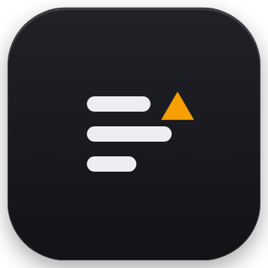
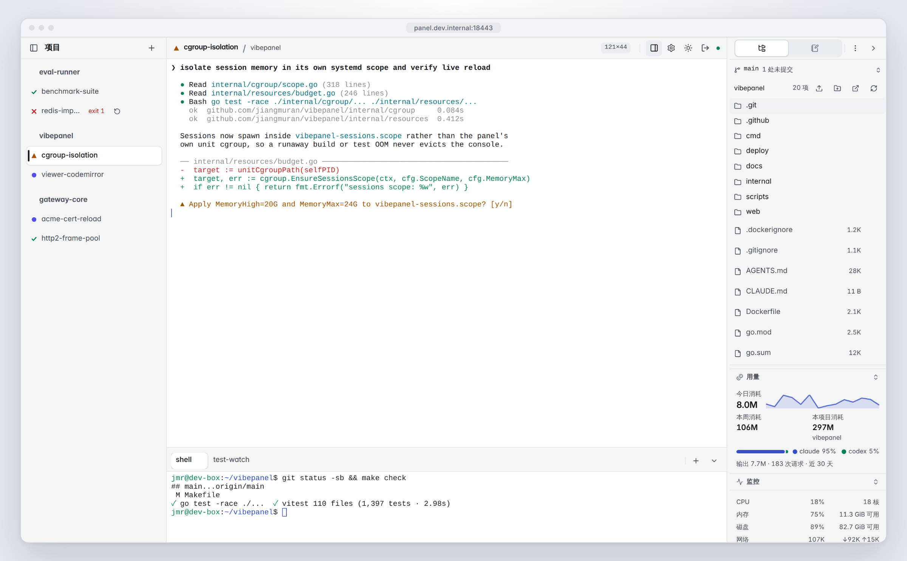
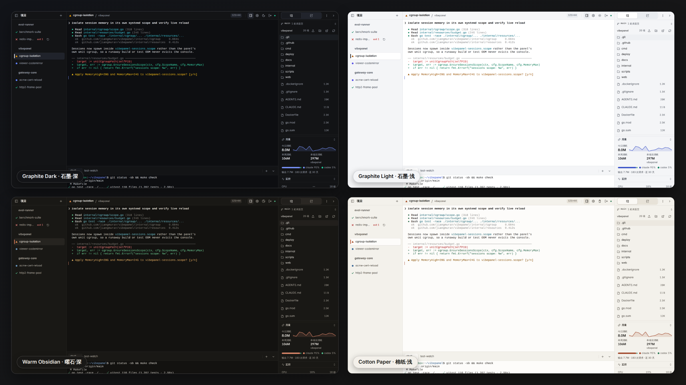
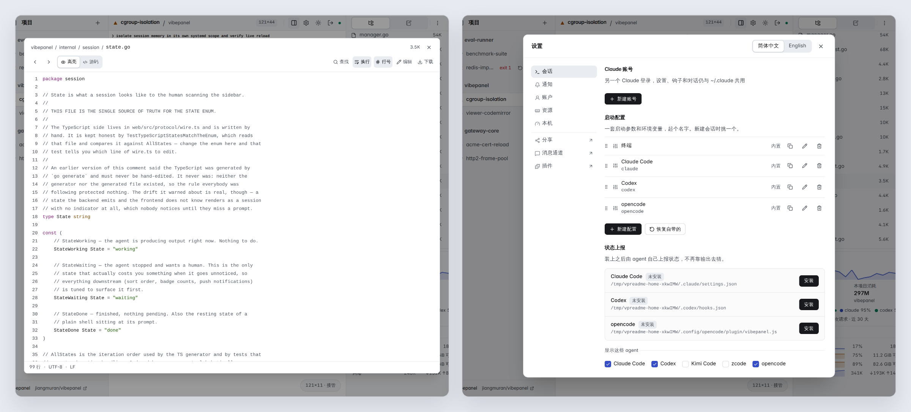
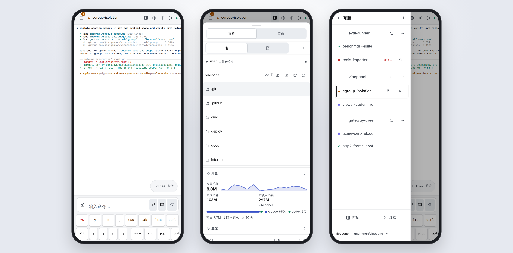
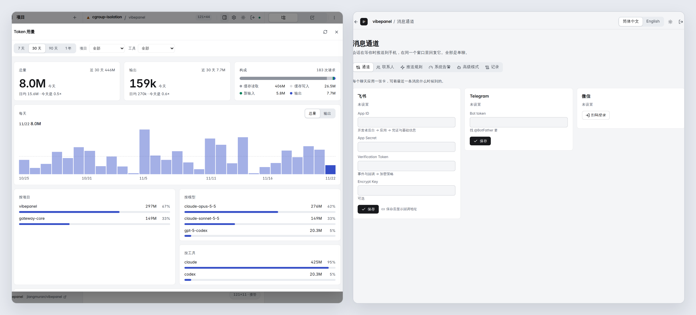
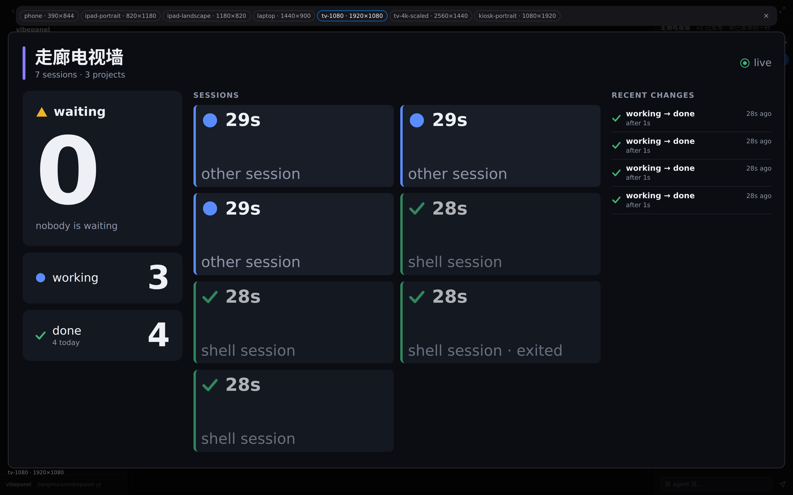
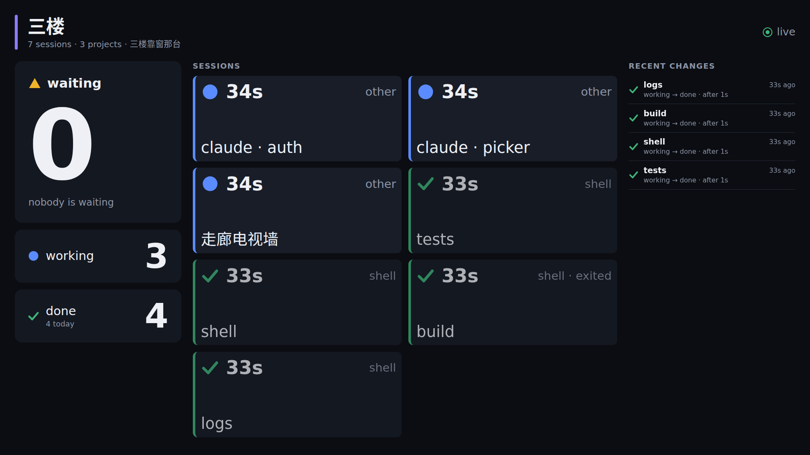
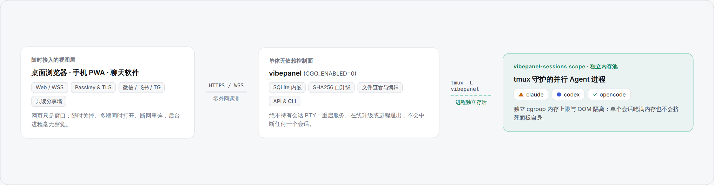

<div align="center">



# vibepanel

**面向多项目、多 Agent 并行开发的自托管 Web 终端工作台**

[](https://github.com/jiangmuran/vibepanel/releases/latest)
[](https://github.com/jiangmuran/vibepanel/actions/workflows/check.yml)
[](https://github.com/jiangmuran/vibepanel/actions/workflows/release.yml)
[-00ADD8?logo=go&logoColor=white)](go.mod)
[](LICENSE)

[English](README.md) · **简体中文**

[快速安装](#快速安装linux--macos) · [核心特性](#核心特性) · [手机与聊天桥接](#手机端与聊天软件桥接) · [架构与安全](#架构与安全边界) · [CLI 与 API](#命令行与-http-api) · [持续维护与测试](#持续维护与测试体系)

</div>

<br>

<p align="center">
  <picture>
    <source media="(prefers-color-scheme: dark)" srcset="docs/images/hero-dark.png">
    
  </picture>
</p>

## 为什么做 vibepanel

同时在几套仓库里开着十几个 Claude Code、Codex 或 opencode 干活时，传统终端标签页很快就会变成盲盒：不知道哪个会话已经跑完、哪个停在权限确认等你拍板、哪个测试进程快把机器内存吃干了。合上笔记本出门，或者服务端面板更新重启，手头的推进节奏就断了。

vibepanel 把「进程存活」和「界面交互」彻底拆开。所有终端会话都运行在独立 socket 的 `tmux` 与独立的 `systemd` cgroup 内存池里；前端控制台打包进单个无依赖的 Go 可执行文件，只负责组织项目、感知状态、浏览编辑文件与多端同步。面板升级、服务重启、甚至单个会话触发 OOM，都不会中断其他正在运行的 Agent。

在桌面上它是干净顺手的三栏工作台；在手机上是专门适配大拇指与中文输入法的移动控制台；甚至不用打开浏览器，接上个人微信、飞书或 Telegram，哪个会话停下来问问题就会推一张卡片到手机单聊，直接回句话或点一下「允许」就能让它继续往下跑。

---

## 快速安装（Linux / macOS）

交互式安装脚本支持简体中文与 English，自动检测系统环境、校核 `SHA256SUMS` 并配置后台服务（`systemd` 系统服务、用户服务或 macOS `launchd`）。

### 标准安装

```sh
curl -fsSL https://raw.githubusercontent.com/jiangmuran/vibepanel/main/install.sh | sh
```

### 国内或网络受限环境

通过维护者提供的公益镜像拉取安装包（首次运行会提示在浏览器完成一次防滥用验证）：

```sh
curl -fsSL https://github.muran.tech/https://raw.githubusercontent.com/jiangmuran/vibepanel/main/install.sh -o vibepanel-install.sh \
  || curl -sSL https://github.muran.tech/https://raw.githubusercontent.com/jiangmuran/vibepanel/main/install.sh
sh vibepanel-install.sh --mirror
```

### 日常服务管理

```sh
vibepanel service status | start | stop | restart | logs | token | upgrade | uninstall
```

无人值守安装参数、用户级与系统级服务对比、命令行创建首账号、Docker 部署及源码编译说明见 [docs/install.md](docs/install.md)。

---

## 核心特性

### 1. 多项目会话编排与双色系四套主题

- **一眼分清轻重缓急**：左侧按项目归组，会话状态同时用颜色和几何形状编码——`▲` 等待输入、`●` 运行中、`✓` 已完成、`□` 正常退出、`×` 异常退出，凌晨关灯看手机或色觉受限都不会看混。需要你处理的会话自动置顶或打角标提醒。
- **底部项目级便签终端**：主终端里的 Agent 正在长篇输出时，不用打断它，直接在下方随项目切换的便签终端里跑 `git status`、看日志或起测试进程。
- **双设计语言 × 深浅四主题**：内置冷中性的 **石墨·浅 / 石墨·深（Graphite）** 与低眩光暖调的 **棉纸·浅 / 曜石·深（Cotton Paper & Warm Obsidian）**，刷新页面前内联脚本直接落色，零白屏闪烁；同时支持安装插件主题。

<p align="center">
  
</p>
<p align="center"><sub>内置四套主题实拍：石墨·深 / 石墨·浅（冷中性工具风）与 曜石·深 / 棉纸·浅（暖色低眩光护眼风）</sub></p>

### 2. 全格式文件查看、就地编辑与精准状态上报

- **开箱即用的内置查看器与编辑器**：右栏直接浏览项目目录、剪贴板一键粘贴截图上传、记录项目备忘。点开文件即可在浏览器内查看语法高亮源码与 Diff、GFM Markdown、PDF（支持全文检索与缩放）、Jupyter `.ipynb`、SQLite 数据表、`.zip`/`.tar` 压缩包目录、图片音视频、字体样张及 5 万行大日志；文本与代码文件按 `e` 即可调起 CodeMirror 6 在线编辑保存，通过 `ETag` 乐观锁防止意外覆盖 Agent 刚改过的文件。
- **不靠猜的 Agent 状态上报**：在「设置 → 会话」中一键为 **Claude Code、Codex、Kimi Code、zcode、opencode、agy** 写入状态上报 Hook（写入前可预览改动并自动备份原配置），准确区分「Agent 真做完了」与「只是安静在想」；同时支持管理多套 Claude 账号凭证与自定义启动参数预设。

<p align="center">
  <picture>
    <source media="(prefers-color-scheme: dark)" srcset="docs/images/viewer-settings-dark.png">
    
  </picture>
</p>
<p align="center"><sub>左：支持查找、跳行与就地保存编辑的内置文件查看器 · 右：多 Claude 账号、启动预设与一键安装各家 Agent 状态 Hook</sub></p>

### 3. 手机端与聊天软件桥接

- **专为触屏重做的移动界面**：手机打开自动切换为满宽终端画布；底部配备防输入法合成乱码、防语音转写重复提交的一体式胶囊输入坞（支持直接从手机相册贴截图进会话），以及带粘滞 `ctrl`/`alt` 和一键收起开关的实体触感快捷键栏；顶栏一键呼出底部 Sheet 查看文件、Token 消耗与小终端。
- **个人微信 / 飞书 / Telegram 单聊联动**：内置自研通道适配（无第三方 SDK，个人微信直接扫码绑定）。Agent 停下等确认或提问时自动推送带编号卡片，Telegram 与飞书卡片底部直接附带 **允许 / 拒绝** 按钮；回一句 `3: 再跑一遍单测` 直达对应终端，回 `截图 3` 实时渲染终端高清图发回手机；开启高级模式后可直接用自然语言指派，后台解析意图后必须等你回复 `ok` 才会真正落盘执行。

<p align="center">
  <picture>
    <source media="(prefers-color-scheme: dark)" srcset="docs/images/mobile-showcase-dark.png">
    
  </picture>
</p>
<p align="center"><sub>左：全宽终端 + 一体式输入坞 + 可折叠键帽栏 · 中：一键升起的底部工作区面板 · 右：多项目状态抽屉</sub></p>

### 4. 本地 Token 账本、内存隔离与可分享屏幕

- **Token 消耗全景看板**：直接读取本机会话日志（零数据外发），在侧栏实时显示近 14 天走势与今日消耗，点开全屏看板查看 53 周热力图、缓存命中与输出占比，以及按项目、按模型、按会话的明细排行。
- **会话内存池与压力兜底**：会话运行在独立的 `vibepanel-sessions.scope` 中。内存逼近上限时控制台顶栏主动告警，定位高占用子进程树并提供一键冻结（`SIGSTOP`）或终止，避免整台开发机死锁。
- **可编程沙箱分享页与插件体系**：需要把项目进度挂上团队大屏或发给外部查看时，可基于模板让 Agent 边写边在右侧实时预览页面，生成的分享链接严格限制在 5 条脱敏路由与 `sandbox` 沙箱内（绝不暴露本机路径、命令参数与真实 ID）。插件系统（[docs/plugins.md](docs/plugins.md)）采用能力表显式授权，支持扩展主题、侧栏窗格、受控 `server.js` 服务与托管子进程。

<p align="center">
  <picture>
    <source media="(prefers-color-scheme: dark)" srcset="docs/images/observability-dark.png">
    
  </picture>
</p>
<p align="center"><sub>左：按项目、模型与工具拆解的本地 Token 账本 · 右：消息通道管理页（未启用前零外部网络连接）</sub></p>

<p align="center">
  
  
</p>
<p align="center"><sub>可分享屏幕：终端旁实时预览不同分辨率效果，发布后通过独立脱敏链接投放到大屏或外部浏览器（<a href="docs/features.zh-CN.md#给别人看的屏幕">详细说明</a>）</sub></p>

---

## 架构与安全边界

<p align="center">
  <picture>
    <source media="(prefers-color-scheme: dark)" srcset="docs/images/arch-zh-dark.png">
    
  </picture>
</p>

- **零外部依赖单体二进制**：前后端资源与纯 Go SQLite 全部静态编译进同一个 `CGO_ENABLED=0` 二进制，无运行时联网下载，不发送任何遥测。内置 TLS 终结（支持自有证书热替换与自动签发续期），支持密码与 WebAuthn Passkey（Touch ID / Windows Hello / 硬件密钥）登录。
- **严格的 tmux 与进程隔离**：只读写专用 `-L vibepanel`（可配置）socket 与独立配置文件，绝不触碰你机器上原有的 tmux 或 zellij 会话。面板本身不作为任何会话进程的父进程，在线自升级会先下载校验 `SHA256SUMS`、试运行新二进制确认健康后再平滑切换。
- **路由级权限收口与隐私默认关闭**：分享令牌、页面管理凭据、聊天工具令牌与插件令牌各自隔离在独立数据表与路由前缀下，不与主登录态混用；聊天桥接在首次手动开启并确认数据流向说明前，不向任何外部服务器发起连接。

---

## 命令行与 HTTP API

同一个 `vibepanel` 二进制既是服务端，也是操作运行中面板的完整 CLI（[docs/cli.md](docs/cli.md)）：

```sh
# 在宿主机或容器内查看所有项目与会话状态
vibepanel status
vibepanel session new --project vibepanel --title "release-audit" -- claude
vibepanel session send release-audit "跑一遍 make check" --enter

# 在面板启动的会话内部，Agent 可以用专属受限令牌汇报自身进度与里程碑
vibepanel me info set summary "正在跑浏览器回归测试"
vibepanel me info set progress 75
vibepanel me say "回归全部通过，等待合并确认"
```

界面上的所有操作均通过同一套 REST + WebSocket 接口完成（完整契约见 [docs/api.md](docs/api.md)）：

```sh
TOKEN=…   # 设置 → 账户 → API 令牌

curl -sX POST https://panel.example.com:18443/api/sessions \
  -H "Authorization: Bearer $TOKEN" \
  -H 'Content-Type: application/json' \
  -d '{"projectId":"…","title":"billing","command":["claude"]}'
```

所有启动参数均有对应的 `VIBEPANEL_<UPPER_SNAKE>` 环境变量；拼写错误或已废弃的 `VIBEPANEL_*` 变量会在启动日志和 `vibepanel doctor` 中显式告警，不会静默失效。

---

## 持续维护与测试体系

vibepanel 在高强度日常自用中持续高频迭代（当前已演进 40 余个正式版本至 `v1.43.x`，每次架构决策与踩坑记录均归档在 [docs/build-log.md](docs/build-log.md) 中）。每次发版均由公开的 GitHub Actions 在洁净环境编译全平台归档并实测安装链路。

```sh
make check         # 快速门禁：go vet、gofmt、tsc、eslint、Go 竞态测试（真 tmux）、前端单测
make head-check    # 拉起干净的 HEAD worktree 独立编译校验，防止漏提文件或前端产物不一致
make verify        # 全量验证门禁：并发跑完下方全部真浏览器与容器回归套件
```

除 Go 竞态单测与前端静态/对比度/契约单测外，仓库维护了 **16 套驱动真实二进制、真实 `tmux`、真实 Chromium 与 Docker `systemd` 容器的端到端检查**：

| 检查目标 | 覆盖范围 |
|---|---|
| `make render-check` | 全界面布局、状态流转、多端尺寸仲裁、深浅对比度扫描、手机触控热区、剪贴板与 Passkey |
| `make preview-check` | 文件查看器与编辑器：全文件类型、三档视口 × 双主题、快捷键、5 万行文件首屏与滚动帧率、CRLF/BOM 保真保存 |
| `make stress-check` | CJK 宽字符对齐、全屏 TUI 程序、长回滚缓冲、输出洪峰与 WebSocket 断线重连 |
| `make restart-check` | 强杀后端进程，验证所有 tmux 会话与登录态完整存活恢复 |
| `make resources-check` | cgroup 内存统计、水位告警横幅、定位并冻结/终止越界进程、全程保持面板响应 |
| `make isolation-check` | 在真实 systemd 249 / 252 / 259 容器内验证 `vibepanel-sessions.scope` 迁移与升级 |
| `make chat-check` | Telegram / 飞书 / 微信通道握手、配对、推送规则预览、工具只读门禁及双语多尺寸排版 |
| `make pages-check` | 分享页 iframe 沙箱逃逸拦截、实时预览与发布回滚闭环、全模板 × 全屏幕规格渲染 |
| `make plugins-check` | 插件安装权限清单、勾选收口、沙箱隔离、进程挂载签名校验与自定义主题热加载 |
| `make panes-check` | 右侧面板分栏拖拽、合并、键盘调宽与布局持久化 |
| `make first-run-check` | 首次启动一次性 Token 认领向导、Origin 信任校验与首个项目创建 |
| `make archive-check` | 项目归档、目录选择器恢复、空闲自动归档设置及后台会话存活验证 |
| `make scale-check` | 二十余个并发会话下的快照体积、侧栏可达性与轮询开销 |
| `make tls-check` | 内置 TLS 终结、`wss://`、Secure Cookie 与证书热替换 |
| `make sudo-check` | 在 sudo 1.9 与 sudo-rs 容器内覆盖各类 `sudoers` 规则下的提权自升级 |
| `make install-check` | 引导脚本与安装器在 Linux / macOS、六种包管理器、各服务模式下的全分支中英双语校验 |

---

## 文档索引

| 文档 | 内容 |
|---|---|
| [docs/install.md](docs/install.md) | 安装方式对比、服务模式、全部启动参数与环境变量、Docker 部署 |
| [docs/features.zh-CN.md](docs/features.zh-CN.md) / [docs/features.md](docs/features.md) | 各项功能的完整使用说明（会话、Hooks、手机端、聊天桥接、分享页、插件） |
| [docs/cli.md](docs/cli.md) | `vibepanel` 命令行管理子命令与会话内 `vibepanel me` 用法 |
| [docs/api.md](docs/api.md) | HTTP 与 WebSocket 完整接口文档（与后端路由表双向自动校验） |
| [docs/file-preview.md](docs/file-preview.md) | 内置文件查看器与在线编辑器的支持格式与安全边界 |
| [docs/share-pages.md](docs/share-pages.md) / [docs/page-backend.md](docs/page-backend.md) | 沙箱分享页架构、数据源守卫与访客交互动作规范 |
| [docs/plugins.md](docs/plugins.md) | 插件能力表（Rung 0–4）、UI 槽位、`server.js` 与托管进程协议 |
| [docs/design.md](docs/design.md) / [docs/runbook.md](docs/runbook.md) | 核心架构决策记录与线上故障排查手册 |
| [docs/build-log.md](docs/build-log.md) / [AGENTS.md](AGENTS.md) | 按时间顺序记录的完整演进日志、工程约定与安全红线 |

---

## 许可证

本项目采用 [PolyForm Noncommercial 1.0.0](LICENSE) 许可证（附加署名条款）。

- **个人使用、学习、研究及其他非商业用途免费**：允许修改代码与分发修改版本，前提是完整保留原始作者署名与许可证声明，并明确标注基于 `vibepanel` 构建。
- **商业用途需单独授权**：包括在公司内部部署使用、作为托管服务对外提供或打包进商业产品等场景，请联系 [jmr@jiangmuran.com](mailto:jmr@jiangmuran.com) 获取商业授权。
- `v1.20.1` 及更早版本以 MIT 许可证发布，按上述版本获取的副本继续适用 MIT 条款。
